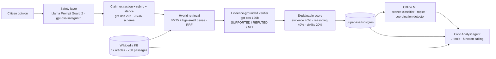

# FactProtest India 🇮🇳

**Claim-level fact-checking, explainable credibility scoring and agentic analysis of public opinion on Indian protests.**

Citizens post opinions about protests (farm laws, NEET paper leak, Agnipath, CAA, Manipur, …). FactProtest breaks
each opinion into checkable factual claims, verifies every claim against a Wikipedia knowledge base with retrieval-augmented
generation, and produces a credibility score that explains itself. A tool-calling AI agent, classical ML models and a
statistics layer turn the opinions into analysis that journalists, researchers and officials can use.

**Live demo:** https://factpotest-india-43fdfkvnzfw6vyuv8vpagk.streamlit.app

> v1 (FORGE Buildathon, Nov 2026) asked an LLM for a single 0–100 number. v2 replaces that with a measurable pipeline:
> retrieval, verification, ML and an evaluation harness. Every metric below is reproducible from this repo.

## Results

All numbers come from `scripts/run_evals.py` / `scripts/train_models.py`; raw outputs are in
[`evals/results/`](evals/results) and [`artifacts/metrics/`](artifacts/metrics), and the protocol is in
[`evals/README.md`](evals/README.md).

**Claim verification**: 105 manually reviewed gold claims (39 supported, 36 refuted, 30 not-enough-info) drafted from
knowledge-base passages by a different model family (Qwen) than the verifier.

| Retriever → verifier | Accuracy | Macro-F1 | Tokens / claim |
|---|---|---|---|
| Hybrid top-3 → gpt-oss-20b | **93.3%** | **0.93** | 648 |

Main failure mode (4 of 7 errors): claims the evidence doesn't mention get marked REFUTED when the evidence tells a
different story, an LLM "closed-world" bias.

**Retrieval**: 75 gold claims with a known source passage. Production uses hybrid because it holds up when citizens paraphrase.

| Retriever | R@1 | MRR@10 | R@1 (paraphrased) | MRR@10 (paraphrased) |
|---|---|---|---|---|
| BM25 | 0.77 | 0.88 | 0.68 | 0.81 |
| Dense (bge-small) | 0.65 | 0.81 | 0.61 | 0.79 |
| **Hybrid (RRF)** | 0.77 | 0.87 | **0.75** | **0.86** |

**Stance detection**: a label audit came first. The corpus generator had labelled stance toward the *policy* instead of the
*protest*: only 57% of its labels matched a manual audit. Re-annotation with each protest's explicit demand reached 95%
agreement with the audit (Cohen's κ = 0.87).

| Model | Protocol | Macro-F1 |
|---|---|---|
| TF-IDF word+char → logistic regression | leave-one-protest-out | 0.40 |
| bge-small embedding → logistic regression | leave-one-protest-out | 0.40 |
| gpt-oss-20b, prompt without the demand | zero-shot (n=100) | 0.43 |
| **gpt-oss-20b, target-aware prompt** | zero-shot (n=395) | **0.75** (82.0% acc.) |

Classical models reach 0.54 on a random split but 0.40 on unseen protests (a domain-shift gap), so production uses the
target-aware prompt.

**Coordinated-campaign detection**: 24 planted copy-paste posts in 3 bursts among 424 opinions. Precision = recall = 1.00 for
cosine thresholds 0.84–0.95. Removing the 3-hour time window drops precision to 0.57, so timing is the signal that
separates campaigns from organic agreement. The same detector found **79.6%** of the retired v1 demo data had a near-duplicate,
versus 1.0% in the new corpus.

**End-to-end** (first 100 corpus opinions fully scored; free-tier quota limits the rest):

| Metric | Value (95% Wilson CI) |
|---|---|
| Opinions with a planted false claim that got a REFUTED flag | 59% (42–74%), n = 32 |
| Accurate-fact opinions wrongly flagged | 25% (13–42%), n = 32 |
| Fact-free opinions wrongly flagged | 3%, n = 35 |
| Score bias by declared stance | Kruskal–Wallis p = 0.94, rank-biserial r = 0.03 (none) |

7 of the 8 false alarms are one claim: "the farm laws were repealed on 19 November 2021". That is the date of the
*announcement*; Parliament passed the repeal on 29 November. The verifier is technically right, which motivates a
PARTIALLY_ACCURATE verdict next.

## Architecture



## What's inside

| Area | Implementation |
|---|---|
| **RAG fact-checking** | Wikipedia articles fetched with pinned revision ids → section-aware 160-word chunks with overlap → `bge-small-en-v1.5` ONNX embeddings (fastembed, no torch) + BM25 → Reciprocal Rank Fusion → claim-level verification with cited evidence ids ([`factprotest/factcheck.py`](factprotest/factcheck.py), [`factprotest/rag/`](factprotest/rag)) |
| **Agentic AI** | Civic Analyst agent with OpenAI-style function calling over 7 tools (stats with bootstrap CIs, semantic opinion search, Wikipedia search, topics, chi-square state test, coordination alerts, authority replies); full reasoning trace shown in the UI; citations linked back to sources ([`factprotest/agent.py`](factprotest/agent.py)) |
| **LLM engineering** | Versioned prompts, Pydantic-validated JSON outputs with automatic repair, batching, per-model token-rate limiting, retry with `retry-after`, token/latency accounting ([`factprotest/llm.py`](factprotest/llm.py)) |
| **AI safety** | Prompt-injection detection (Llama Prompt Guard 2) caps the score of manipulative inputs; policy-based moderation (gpt-oss-safeguard); user text is always treated as data |
| **Explainability** | The score is a documented weighted combination of evidence, reasoning and civility, with per-claim verdicts, evidence snippets and flags ([`factprotest/scoring.py`](factprotest/scoring.py)) |
| **Machine learning** | Stance classification: TF-IDF (word+char) + logistic regression vs sentence-embedding + logistic regression vs LLM zero-shot, evaluated with leave-one-protest-out CV. Topic discovery: KMeans on embeddings with k by silhouette, c-TF-IDF keywords, LLM labels. Coordinated-campaign detection: cosine near-duplicates within a time window → union-find clusters ([`factprotest/ml/`](factprotest/ml)) |
| **Statistics** | Leik's ordinal polarization index, percentile-bootstrap 95% CIs, chi-square test of stance × state with Cramér's V, Kruskal–Wallis / Mann–Whitney audit of the scorer for stance bias with rank-biserial effect size ([`factprotest/analytics.py`](factprotest/analytics.py)) |
| **Evaluation** | Reviewed 105-claim gold set, retrieval ablation incl. paraphrase robustness, verifier configurations incl. oracle evidence, end-to-end misinformation recall, stability across reruns ([`evals/`](evals)) |
| **Engineering** | Repository pattern (Supabase / local JSONL), 27 offline unit tests with fake LLM clients, ruff, GitHub Actions CI, resumable batch jobs |

## App pages

* **Protests**: browse protests, submit an opinion and watch it get fact-checked claim by claim.
* **Fact-Check Lab**: run the pipeline on any text (try the built-in false-claim and prompt-injection examples).
* **AI Analyst**: ask questions in plain English; the agent plans tool calls and answers with citations.
* **Data Insights**: consensus map (support vs polarization), regional chi-square tests, scorer-bias audit, topics, coordination alerts.
* **Model Card & Evals**: every metric in this README, rendered from `evals/results/`.
* **Authority Portal**: review queue of refuted or flagged opinions and official replies.

## Data

* **Knowledge base**: 17 English Wikipedia articles (CC BY-SA 4.0), 760 passages; revision ids in `data/kb/sources.json`.
* **Opinion corpus**: 424 **synthetic** opinions in `data/corpus/`: 400 generated by `gpt-oss-120b` from explicit persona
  specs (stance, state, writing style including Hinglish and sarcasm, and whether to include an accurate fact, a false fact
  or no fact), plus 24 rule-based posts forming 3 coordinated campaigns. Synthetic data gives ground truth that real
  data would not (true stance, which claim is false, which posts are coordinated); it is labelled as synthetic in the app.
* The v1 demo data (1,000 template-generated opinions with randomly assigned scores) has been retired.

## Run it

```bash
python -m venv .venv && source .venv/bin/activate
pip install -r requirements-dev.txt
# .streamlit/secrets.toml needs GROQ_API_KEY, SUPABASE_URL, SUPABASE_KEY, AUTHORITY_PWD
streamlit run app.py                         # against Supabase
FACTPROTEST_DATA=local streamlit run app.py  # offline demo on the committed corpus
pytest -q && ruff check .
```

Rebuild everything from scratch:

```bash
python scripts/build_kb.py             # Wikipedia → chunks → embeddings
python scripts/generate_corpus.py      # synthetic opinions with ground truth
python scripts/score_corpus.py         # full pipeline over the corpus (resumable)
python scripts/build_gold_claims.py    # draft gold claims (then review)
python scripts/train_models.py         # stance, topics, coordination
python scripts/run_evals.py retrieval  # also: paraphrase, verify, endtoend, consistency, summary
```

## Repository layout

```
factprotest/        core library: llm, prompts, schemas, factcheck, scoring, safety, agent, analytics, data
  rag/              chunking, embeddings, hybrid retriever
  ml/               stance, topics, integrity (coordination)
ui/                 Streamlit pages and components
scripts/            KB build, corpus generation, scoring, training, evaluation, Supabase sync
data/               knowledge base and corpus
evals/              gold set, review log, results
artifacts/          trained models and metrics
tests/              offline unit tests
```

## Limitations

* Wikipedia can lag events or reflect contested framings; a claim it does not cover is NOT_ENOUGH_INFO, never REFUTED.
* Corpus metrics measure the pipeline on synthetic data, not real Indian public opinion.
* A credibility score rates evidence, reasoning and civility, not whether a viewpoint is right.
* Free-tier LLM rate limits bound throughput.
